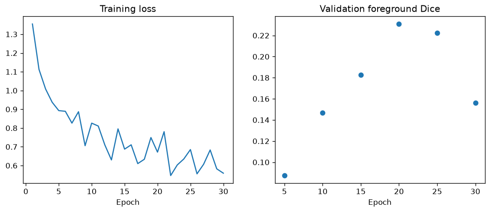
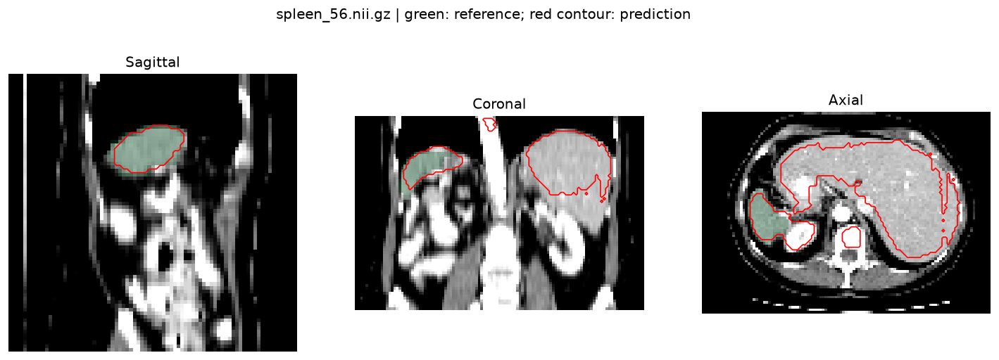

# Spleen Segmentation from 3D CT Scans

This project trains a **3D U-Net** to outline the spleen in CT scans using **PyTorch and MONAI**. Instead of assigning one label to an entire image, the model predicts whether each voxel belongs to the spleen and produces a binary segmentation mask.

The main notebook, [`ct.ipynb`](ct.ipynb), contains the executed workflow: library imports, scan and label checks, CT visualizations, preprocessing, training, validation, held-out testing and prediction overlays. This is a learning project that moves beyond image classification into medical image segmentation.

## What the project demonstrates

- Loading 3D CT volumes and segmentation masks from NIfTI files.
- Detecting missing labels, mismatched shapes and spatial alignment, invalid mask values, empty organs and nonfinite voxels before training.
- Visualizing the CT and spleen mask in three planes.
- Splitting by complete patient volumes to keep training, validation and testing separate.
- Resampling scans, scaling CT intensities and extracting balanced spleen/background training patches.
- Training a 3D U-Net with Dice plus cross-entropy loss and saving checkpoints.
- Using sliding-window inference to segment full evaluation volumes.
- Measuring foreground Dice per test case and exporting a prediction mask.

**Dice score** measures the overlap between a predicted mask and the reference mask:

```text
Dice = 2 × overlapping foreground voxels / (predicted foreground voxels + reference foreground voxels)
```

A score of 1 means perfect overlap. Background is excluded from the reported Dice score.

## Dataset

The project uses **Task09 Spleen** from the [Medical Segmentation Decathlon](http://medicaldecathlon.com/), following the [official MONAI spleen segmentation tutorial](https://github.com/Project-MONAI/tutorials/blob/main/3d_segmentation/spleen_segmentation_3d.ipynb).

The dataset contains 41 labeled CT volumes and 20 official test volumes without public reference masks. Because Dice requires reference masks, this project reserves part of the labeled dataset for quantitative testing:

| Partition | Volumes | Purpose |
| --- | ---: | --- |
| Training | 25 | Learn the network weights |
| Validation | 8 | Select the best checkpoint |
| Held-out testing | 8 | Measure final segmentation overlap |

The split uses seed **42** and is saved in [`splits.json`](artifacts/cpu_baseline/splits.json). No patches from validation or test volumes enter training. All 41 labeled scans passed the data audit.

Download [`Task09_Spleen.tar`](https://msd-for-monai.s3-us-west-2.amazonaws.com/Task09_Spleen.tar) using the link supplied in the MONAI tutorial and place it beside `ct.ipynb`. The notebook extracts it automatically:

```text
Task09_Spleen/
├── dataset.json
├── imagesTr/
├── labelsTr/
└── imagesTs/
```

The complete raw archive is included as 12 smaller Git LFS files in `dataset_parts/`, so interrupted transfers can retry individual pieces. Install Git LFS before cloning and run `git lfs pull`. Then run `python restore_dataset.py` to reassemble the checksum-verified original archive. The notebook also reassembles it automatically before extraction. Allow space for the downloaded parts, reconstructed archive and extracted dataset. The original download link remains available as an alternative. The 1.6 GB archive exceeds [GitHub's ordinary repository file limit](https://docs.github.com/en/repositories/working-with-files/managing-large-files/about-large-files-on-github). Installed Python packages, runtime connection files and regenerated preprocessing caches are excluded. The notebook, code, trained weights, figures and measured results are included.

## Measured training and test results

The saved experiment is an actual **30-epoch CPU training run**, using all 25 training cases; it is not a smoke run.

| Setting or result | Value |
| --- | --- |
| Model | 3D U-Net with 1 input channel and 2 output classes |
| Feature channels | 8, 16, 32, 64, 128 |
| Trainable parameters | 1,202,793 |
| Voxel spacing | 3 × 3 × 3 mm |
| Training patch | 48 × 48 × 48 voxels |
| Inference window | 96 × 96 × 96 voxels |
| Patches per training case | 2 |
| Optimizer | Adam, learning rate 0.001 |
| Epochs | 30 |
| Best checkpoint | Epoch 20 |
| Best validation Dice | 0.231 |
| Mean held-out test Dice | **0.192** |
| Test Dice standard deviation | 0.071 |
| Held-out test cases | 8 |

**The baseline has poor segmentation overlap.** The worst-case prediction contains substantial false-positive regions outside the spleen. These results demonstrate a complete training and evaluation pipeline, but do not demonstrate an accurate organ segmentation model. Larger training context, finer voxel spacing and longer training are possible next experiments; model choices should use validation data while keeping the test split separate.





## Run the project

The recorded environment used Python **3.14**, PyTorch **2.14.1+cpu** and MONAI **1.6.1**. Exact installed package versions are recorded in [`requirements-lock.txt`](requirements-lock.txt). [`requirements.txt`](requirements.txt) lists the direct dependencies.

Create an isolated environment and install the libraries. On Windows PowerShell:

```powershell
python -m venv .venv
.\.venv\Scripts\python.exe -m pip install -r requirements.txt
```

On macOS or Linux:

```bash
python3 -m venv .venv
.venv/bin/python -m pip install -r requirements.txt
```

Download the dataset as described above. Open `ct.ipynb` in VS Code or Jupyter and select the new virtual environment as its Python kernel. To execute all cells and save the outputs automatically:

```powershell
.\.venv\Scripts\python.exe execute_notebook.py
```

On macOS or Linux, use `.venv/bin/python execute_notebook.py` instead.

The default `SMOKE_TEST=False` trains on the complete training partition. CPU mode uses the settings above. GPU mode uses 100 epochs, larger training patches and finer spacing; install the appropriate CUDA-enabled PyTorch build using the [official installation instructions](https://pytorch.org/get-started/locally/). Set `SMOKE_TEST=True` only for a one-epoch check on a small subset.

Rerunning the notebook starts training from scratch and updates the matching output directory. It does not automatically resume from `last_model.pt`. Preprocessing caches are rebuilt when needed.

## Files and saved artifacts

| File or directory | Contents |
| --- | --- |
| `ct.ipynb` | Executed end-to-end segmentation notebook |
| `restore_dataset.py` | Reassembles and verifies the Git LFS dataset archive |
| `execute_notebook.py` | Runs the notebook with an isolated project kernel |
| `build_notebook.py` | Regenerates the notebook structure and clears its outputs |
| `verify_notebook.py` | Checks notebook syntax and masks inside the dataset archive |
| `record_results.py` | Adds the recorded CPU experiment results to the notebook |
| `check_validation_context.py` | Compares inference window sizes on validation cases |
| `finish_export.py` | Recreates the prediction export from the saved checkpoint |
| `notebook_verification.json` | Saved verification report |
| `artifacts/cpu_baseline/best_model.pt` | Best model weights and training configuration |
| `artifacts/cpu_baseline/last_model.pt` | Final model, optimizer state and training history |
| `artifacts/cpu_baseline/label_audit.csv` | Scan and mask audit |
| `artifacts/cpu_baseline/run_config.json` | Exact experiment settings and package versions |
| `artifacts/cpu_baseline/training_history.csv` | Training loss and validation Dice by epoch |
| `artifacts/cpu_baseline/test_metrics.csv` | Per-case held-out Dice scores |
| `artifacts/cpu_baseline/test_summary.json` | Mean and standard deviation of test Dice |
| `artifacts/cpu_baseline/*.png` | CT overlays, training patch, volume distribution and learning curves |
| `artifacts/cpu_baseline/held_out_prediction_resampled.nii.gz` | Exported binary prediction mask |

The exported mask is on the **resampled evaluation grid**, with its corresponding affine. It is not an original scanner-grid export. Use MONAI's inverse transforms when original-space predictions are needed.

## Verification

The recorded notebook contains 11 executed code cells and no cell errors. Verification checked that all 41 masks were readable, binary, nonempty and shape-matched. The notebook additionally checked image finiteness and scan/mask affine alignment. The exported prediction was checked for binary values and 3 mm voxel spacing.

To repeat archive and notebook checks after downloading the data:

```powershell
.\.venv\Scripts\python.exe verify_notebook.py
```

## References

- [MONAI spleen 3D segmentation tutorial](https://github.com/Project-MONAI/tutorials/blob/main/3d_segmentation/spleen_segmentation_3d.ipynb)
- [Medical Segmentation Decathlon](http://medicaldecathlon.com/)
- [MONAI project](https://monai.io/)
- [PyTorch](https://pytorch.org/)
